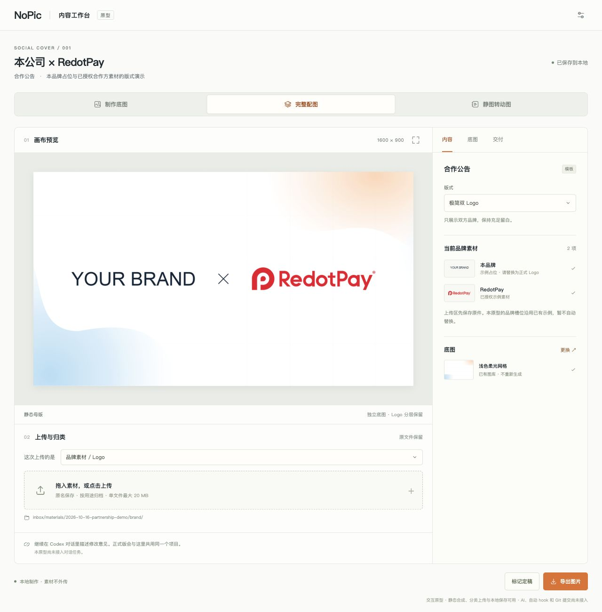
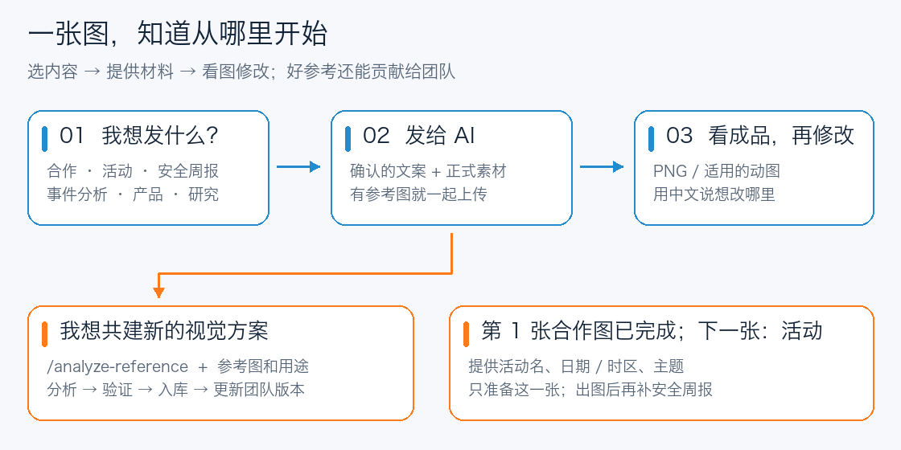
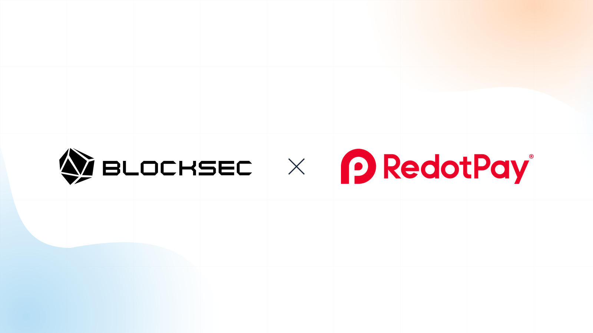

# 有图 NoPic

**Need pics? Call NoPic.** An experimental AI skill for marketing visuals.

**既能交付无字底图，也能制作可编辑的完整封面；有好参考，也可以贡献给团队。**

调用：`$blocksec-social-cover`。首次使用会介绍能力并确认类型，之后直接用中文提出需求。

[NoPic 预览工作台与启动说明](output/prototypes/cover-workbench/README.md) · [单文件外观预览](output/prototypes/cover-workbench/preview.html)

<a href="output/prototypes/cover-workbench/preview-nopic.jpg"></a>

<a href="assets/references/readme-workflow.png"></a>

## ① 你准备发什么？

| 内容 | 可以做成 | 直接这样说 |
| --- | --- | --- |
| **Partnership** | 双 Logo 合作公告；可继续做背景动效 | 做一张合作公告，用附上的双方 Logo |
| **活动** | 预告、回顾、嘉宾金句 | 把这些活动信息做成预告 / 回顾 |
| **安全周报** | 周报封面、阶段汇总、精选要点 | 做本期安全周报，用这个日期范围和摘要 |
| **安全事件** | 攻击 / 漏洞 / 复盘文章配图 | 为这篇事件分析做一张封面 |
| **产品更新** | 功能发布配图、真实 UI 展示 | 用这张 UI 截图做功能更新配图 |
| **研究观点** | 文章封面、署名观点人物卡 | 把这段观点做成配图 |

没有合适类型？选择 **“都不是，新建配图类型”**，说明用途与平台，有参考图就一起发。

## ② 三步拿到第一张图

**说用途** → **发文案 / Logo / 人物或截图** → **看成品，用中文修改**。

```text
使用 $blocksec-social-cover，制作一张用于领英 / X 的合作公告。
标题和说明用下面的确认文案，双方正式 Logo 已附上。
复用已有底图；出图后保留可修改的项目。
```

想改哪里直接说：“标题大一点”“只换合作方 Logo”“背景再淡一些”。

完整封面默认同时保存 PNG / WebP、无字底图和可重编译项目，后续改标题不用重新生成背景。静图与循环动图是同一主题的两种呈现；要求动图时，在同一个项目保留动效配置并导出 MP4 / GIF，文案和素材共用。只需要背景时可以直接说“给我一套无字 Blog 底图”或“同一主题导出 X / LinkedIn 无字版本”，无需提供标题或 Logo。

Blog、X、LinkedIn、微信公众号与 OG 使用独立平台配置。跨画幅封面需适配排版与检查安全区，不拉伸成图。[两种交付模式与可编辑项目说明](references/asset-model.md)

## ③ 示例图库：一张一张生成

第 1 张 **Partnership 已完成**。接下来做活动配图，再做安全周报，每次只准备一张的材料。

| 第 1 张 · Partnership | 第 2 张 · 活动 | 第 3 张 · 安全周报 |
| --- | --- | --- |
| <a href="assets/examples/partnership-redotpay-minimal/cover.png"></a> | **下一张**：活动名、日期 / 时区、主题 | **随后制作**：日期范围、标题、确认摘要 |
| BlockSec × RedotPay，极简无文案；仅展示版式 | 先做预告；回顾或金句可随后补 | 不补造统计或数字 |

**现在只需要准备第 2 张：**

```text
继续做 README 的活动预告示例。
活动名：……
日期与时区：……
主题：……
嘉宾 / 主办信息：……（如需展示）
这些信息和成品允许用于 README 示例。
```

点击已完成图片可查看原图。[逐步制作指南](references/example-walkthrough.md)

<details>
<summary>先看已有底图风格（底图参考，不是完整海报）</summary>

| 合作浅色 / 暖橙 | 黑底蓝橙光晕 | 活动竖版 |
| --- | --- | --- |
| <a href="assets/backgrounds/partnership-soft-grid-light.png"></a><br><a href="assets/backgrounds/partnership-orange-grid-light.png"></a> | <a href="assets/backgrounds/hex-glow.png"></a> | <a href="assets/backgrounds/portrait-data-glow.png"></a> |

[完整底图库与模板说明](references/user-manual.md#可用底图与主题)

</details>

## 想做动图，或者共同维护？

| 目标 | 入口 | 你提供什么 |
| --- | --- | --- |
| 配图的动态版本 | `/animate-cover` | 已确认配图及实际动画源；与静图共用项目，现有配方为前景固定、背景网格循环 |
| 官网 / 落地页 / 邮件产品动图 | `/product-motion` | 产品、想传达的价值、投放位置；使用独立 Carrot |
| 贡献参考、改进类型 | `/analyze-reference` | 优秀配图或成品 + 用途 + 想借鉴 / 改进的部分 |

**共建：发参考 → 看设计规格 / 验证图 → 确认入库 → 更新团队版本。**

```text
/analyze-reference
参考附图，为 BlockSec 安全周报整理一套新的视觉方案。
请分析字体、版式、底图提示词和图层参数，验证后加入共享参考库。
```

[同事共建指南](references/contributors-guide.md) · [团队更新与发布](references/team-sharing.md)

<details>
<summary>需要更多说明时再打开</summary>

- [详细使用手册与中文示例](references/user-manual.md)
- [内容分类](references/content-types.md) · [模板参数](references/template-parameters.md)
- [首次使用](references/first-invocation.md) · [素材收件](inbox/materials/README.md)
- [参考库](assets/reference-library/index.json) · [示例状态](assets/examples/index.json)
- [静图转动图](references/static-to-motion.md) · [产品营销动图](references/product-motion.md)

</details>
