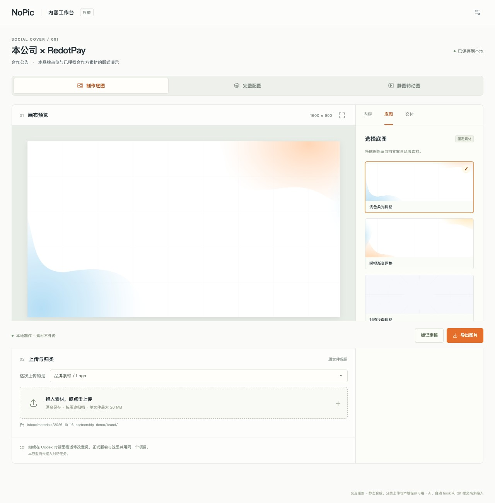

# 有图 NoPic

**文案写好了，配图还没着落？** 把用途、文案和素材发给 AI，先做一张，再用中文改到合适。

**Need pics? Call NoPic.** An experimental AI skill for marketing visuals.

[](https://github.com/eureka266/NoPic/stargazers)
[](https://github.com/eureka266/NoPic/forks)
[](https://github.com/eureka266/NoPic/issues)
[](https://github.com/eureka266/NoPic/commits/main/)

```bash
npx skills add eureka266/NoPic --skill blocksec-social-cover --agent codex
```

<a href="docs/assets/partnership-example.png"></a>

占位排版演示：本品牌与合作方均使用文字占位，正式发布前需替换为双方授权的 Logo。这不是客户案例或合作公告。[查看演示配置](output/prototypes/cover-workbench/demo-assets/content.json)

## 适合哪些配图？

| 你手上有什么 | 可以尝试做成什么 |
| --- | --- |
| 双方 Logo + 合作文案 | 合作公告 |
| 活动信息、嘉宾照片或金句 | 活动预告、回顾、人物卡 |
| 文章、周报摘要或研究观点 | 文章封面、周报封面、观点配图 |
| 产品截图 + 已确认的更新说明 | 产品更新配图 |

拿到的不只是一张 PNG：默认保留 **PNG / WebP、无字底图和可重编译项目**。下次改标题、换 Logo，继续修改原项目。文案和 Logo 分层合成，已有底图可以反复使用。

这是一个实验项目，适合先做初稿、复用已有版式。当前模板和素材主要来自一个既有品牌项目；其他品牌使用时，请提供自己的正式 Logo、字体和配色，并明确替换默认品牌。跨平台版本仍需检查排版和安全区。

## 三步开始

1. **安装到你准备制作配图的项目。** 在该项目的终端运行上面的一行命令；安装器询问时选择项目级安装。安装后运行 `npx skills list --agent codex`，应看到 `blocksec-social-cover`。
2. **打开新对话，发出第一条需求。** 仓库名是 **NoPic**，当前技能调用名仍是 **`$blocksec-social-cover`**，安装时看到旧名称属于正常情况。
3. **附上素材，看图后继续修改。** 可以直接说“只换标题”“Logo 小一点”“保留底图，再出一个版本”。

任选一句开始，附上对应文案或素材：

```text
使用 $blocksec-social-cover，给这篇文章做一张领英封面。
用我附上的品牌 Logo 和确认文案，先复用已有底图，保留可编辑项目。
```

```text
使用 $blocksec-social-cover，把这些活动信息和嘉宾照片做成预告。
只用我提供的信息，不补造日期、嘉宾身份或数据。
```

```text
使用 $blocksec-social-cover，只把上一张图的标题换成下面这句。
其他文案、Logo、背景和位置保持原样。
```

**只需要底图？** 直接说“给我一套无字 Blog 底图”，不用准备标题或 Logo。下图展示的是已有底图素材，不是完整海报。

| 浅色合作 | 深色文章 | 活动竖版 |
| --- | --- | --- |
|  |  |  |

## 首次出图前检查

- [ ] **可执行本地脚本的 AI 助手**：本页以 Codex 为例，安装入口见 [Codex](https://developers.openai.com/codex/)。普通聊天窗口仅粘贴需求，不能替代本地脚本环境。
- [ ] **Node.js 与 Git**：用于上面的技能安装命令。从 [Node.js](https://nodejs.org/en/download) 和 [Git](https://git-scm.com/downloads) 安装，运行 `node --version`、`npx --version`、`git --version` 确认。
- [ ] **Python 3.10+、Pillow、fontTools**：从 [Python](https://www.python.org/downloads/) 安装并运行 `python3 --version`。可以让助手按下面命令建立项目虚拟环境。
- [ ] **自己的文案、正式素材与适用字体**：中文需要覆盖中文字形的字体，例如 [Noto CJK](https://github.com/notofonts/noto-cjk)。不要用预览中的 `YOUR BRAND` 占位直接发布。

在安装技能的项目目录执行，Windows 将 `.venv/bin/python` 换成 `.venv\Scripts\python.exe`：

```bash
python3 -m venv .venv
.venv/bin/python -m pip install -r .agents/skills/blocksec-social-cover/requirements.txt
.venv/bin/python -c "from PIL import Image; from fontTools.ttLib import TTFont; print('Ready')"
```

**按需准备：** 复用底图做静图不需要生成新背景。新绘制背景或人物抠图需要助手实际提供原生图像生成 / 编辑工具；动图还需动画源与 FFmpeg（安装见 [FFmpeg](https://ffmpeg.org/download.html)，用 `ffmpeg -version` 检查）。产品演示动图另依赖独立的 Carrot 技能，本仓库不包含它。

## 想先看看界面？

下面是本地预览工作台原型，可切换已有底图、修改部分文案并导出静态图。**技能主要通过对话使用，工作台是可选交互面板**；在 Codex 中用自然语言调用 skill 时，会自动启动并尝试在右侧打开工作台。工作台通过共享本地状态和会话任务清单连接当前会话，但浏览器不能直接向当前会话注入消息。“用 AI 做新底图”支持把参考图直接粘贴给 Codex，也支持工作台上传或粘贴；含字完整海报可以先提炼风格提示词，再按选择由当前对话生成无字底图。网页负责准备任务与回读分析；任意 Logo 槽位替换和动画制作仍未接入。

<a href="docs/assets/workbench.jpg"></a>

[启动本地工作台](output/prototypes/cover-workbench/README.md) · [下载单文件外观预览](https://github.com/eureka266/NoPic/blob/main/output/prototypes/cover-workbench/preview.html) · [刷新文档插图](docs/release.md)

## 有喜欢的参考图，但不会写设计提示词？

在工作台“底图 → 用 AI 做新底图”中，默认选择“粘贴到 Codex 对话”。想法可以留空，也可以写“喜欢暖色和光感，想更干净，左侧放标题”。点击“准备风格分析任务”，回到当前 Codex 对话，把**参考图与复制的任务提示一起发送**。带标题、Logo、人物的完整海报也可以，AI 会提炼背景的配色、材质、光影与构图，给出无字底图提示词。

也可以在工作台上传、拖入或粘贴图片，勾选本次参考。默认先分析；选择“提炼后直接生成无字底图”才会要求 Codex 新绘制。分析保存后会回到工作台供修改，再准备下一次任务。原图与当前底图保留，新图在对话里核对后决定采用。[完整操作与示例](references/background-style-workflow.md)

## 常见问题

| 遇到什么 | 怎么处理 |
| --- | --- |
| `npx` 或 `git` 找不到 | 安装上面的 Node.js / Git，重新打开终端，再运行版本检查。 |
| 安装后没有 NoPic / 找不到技能 | 查找技术名 `blocksec-social-cover`；运行 `npx skills list --agent codex`，确认安装项目与当前项目一致，再开新对话。仓库发现检查：`npx skills add eureka266/NoPic --list`。 |
| `No module named PIL` 或 `fontTools` | 按依赖命令安装，并让助手使用该 `.venv` 的 Python 执行渲染脚本。 |
| 中文出现方框 / `Font lacks characters` | 提供覆盖这些文字的字体，交给助手设置 `font` / `font_bold`；不要仅改文件后缀。 |
| 改字后图没更新 / 只剩一张 PNG | 提供原项目目录重新编译；只有 PNG 时无法可靠恢复独立图层。[项目说明](references/asset-model.md) |
| 单文件预览不能真实保存 / 导出 | `preview.html` 仅供外观体验；真实操作需要启动本地服务。[启动说明](output/prototypes/cover-workbench/README.md) |
| 工作台如何交给 Codex 会话 | 自然语言调用 skill 会自动启动并尝试打开右侧面板；上传素材后点击“准备当前会话任务”，工作台会生成 `.nopic/workspace/session-handoffs/latest.json` / `latest.md` 并复制提示词，回到当前会话粘贴即可。 |
| 参考图里有标题、人物或 Logo 怎么办 | 在“用 AI 做新底图”中先分析风格，或直接把图粘贴给 Codex 说“只提炼底图风格，先不生成”。AI 排除前景，给出可编辑提示词；不会自动把原海报当成底图。 |
| 如何让同事复用品牌资产 | 将带 `manifest.json` 的 NoPic 品牌素材 ZIP 附到 Codex 对话，要求安装品牌包；skill 会自动安装到当前项目 `.nopic/brand-packs/`，无需指定 skill 路径。[品牌素材包说明](references/brand-pack.md) |

## BlockSec 设计质量检查

新增可独立使用的 [`blocksec-design-quality`](skills/blocksec-design-quality/SKILL.md)（0.2.0），用于审阅前端 UI、营销网页与内容配图。它按任务匹配视觉方向，依据带来源的设计基线检查品牌、层级与系列一致性，并区分“通过 / 需修改 / 待验证”。没有真实作品时不会声称视觉验收通过；团队审美偏好仍需示例校准。

```bash
npx skills add eureka266/NoPic --skill blocksec-design-quality --agent codex --full-depth
```

例如：“使用 `$blocksec-design-quality` 审阅这组 BlockSec 配图，只报告问题，按影响排序。”也可以在 NoPic 制作会话中直接要求“按设计质量规则做 QC”。[检查细则](skills/blocksec-design-quality/references/quality-lenses.md) · [设计基线](skills/blocksec-design-quality/references/design-baseline.md) · [场景评测](skills/blocksec-design-quality/evals/README.md)

## 继续了解与反馈

[详细手册](references/user-manual.md) · [平台与项目导出](references/asset-model.md) · [动图说明](references/static-to-motion.md) · [提交问题](https://github.com/eureka266/NoPic/issues) · [项目动态](https://github.com/eureka266/NoPic/activity)

想贡献新风格？提供参考图、用途和希望借鉴的部分，用 `/analyze-reference` 开始。[共建指南](references/contributors-guide.md)

感谢 [Vercel Labs 的 Skills CLI](https://github.com/vercel-labs/skills) 提供安装工具、[Pillow 维护者](https://github.com/python-pillow/Pillow) 与 [fontTools 项目](https://github.com/fonttools/fonttools) 提供图像合成及字体检查能力；文档截图使用 [Microsoft Playwright](https://github.com/microsoft/playwright-python)。

**素材与许可：** 示例仅用于展示已获准的版式，品牌标识、字体和参考素材各自保留原权利；不能据此推断获得商用或再分发许可。仓库尚未选定统一开源许可证。[发布检查与已知待办](docs/release.md)
