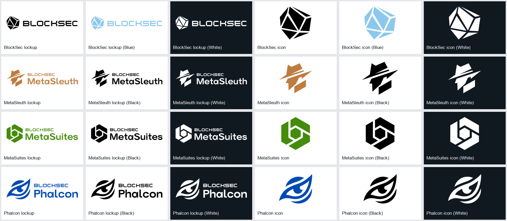

# Media Kit 品牌与产品素材

制作涉及 BlockSec、MetaSleuth、MetaSuites、Phalcon 的 Logo 或独立图标时，先读 [Logo 索引](../assets/logos/index.json)。使用社交图标或已有宣传横幅时再读 [辅助素材索引](../assets/media-kit.json)。文件路径相对于各自索引所在目录解析，不依赖原 iCloud 路径。

## 命名与查找

- `assets/logos/{品牌}/` 按 `blocksec`、`metasleuth`、`metasuites`、`phalcon` 分组。
- 文件名为 `{品牌}-{lockup 或 icon}-{颜色}.{png 或 svg}`；`lockup` 是完整标识与字标，`icon` 是独立图标。颜色用 `black`、`white`、`blue` 或 `color`，实际颜色以索引为准。
- 本批次有 24 组 PNG/SVG：每品牌完整 Logo 三个颜色版本，独立图标三个颜色版本。既有 BlockSec 素材也统一放在 `assets/logos/blocksec/`，索引 ID 保留兼容，完全相同的 SVG 别名复用同一文件。
- 索引 `file` 为原素材使用副本，`vector_file` 为配对 SVG，`render_file` 为合成器实际使用的 PNG。Phalcon 白色完整 Logo 的源 PNG 仅 348×104，合成选 SVG 导出的 2097×634 透明副本。

## 选用规则

先匹配用户指定品牌或产品，再选形态和颜色；未指定产品标识时使用 BlockSec 主品牌。一般使用完整 Logo，只有图标位或用户要求图标时使用 `icon-only`。用户明确选定的版本、现有项目中的选定版本优先，新增项目可按 `brand_defaults` 推荐项选择。

深底优先同品牌白色版。浅底 BlockSec 默认沿用已有黑色版；三个产品默认使用原色完整 Logo，也可指定黑色版。原色和浅蓝版本必须检查实际背景上的可读性，必要时切到同品牌正式白色或黑色版本，不自行染色。

各产品标识保留原色：本批次 MetaSleuth 为 `#BD7C40`，MetaSuites 为 `#448C0C`，Phalcon 为 `#004AB2`，BlockSec 浅蓝版为 `#8DC8EC`。这些是所提供 Logo 的实际素材颜色，不自动扩展为营销海报的全局配色规范。Phalcon 文件标识为 Phalcon，不登记为 Phalcon Compliance 或其他系列的专用 Logo。

用户只需说“使用 MetaSleuth 白色完整 Logo”或“使用 Phalcon 蓝色图标”；agent 读取索引找到 PNG，并将实际路径写入内容配置或通过 `--asset logo=...` 传给合成器。渲染脚本不会自动读取索引。

## Phalcon Compliance 专属 Logo

用户提供的独立 SVG 已下载为 `assets/logos/phalcon-compliance/phalcon-compliance-lockup-dark.svg`，并导出同源透明 PNG `phalcon-compliance-lockup-dark.png`（1872×336）。标识颜色为深蓝灰 `#202939`，不含背景或宣传语；原下载文件保存在 `inbox/materials/2026-10-14-phalcon-compliance-logo/`。

索引 ID 为 `phalcon-compliance-lockup-dark`，是本产品浅色背景的默认正式 Logo，使用其 `render_file` 合成。原 SVG 156×28，PNG 按 12 倍等比导出；没有重画或改色。当前没有白色专属版本，查 `brand_status`，不自行反色，也不以通用 Phalcon 标识替代。

此前 `phalcon-compliance-brand-banner` 是 1920×288 的完整横幅，仍在 Logo 与辅助素材索引中标为参考。它含背景和宣传语，不能直接作独立 Logo 或无字底图；仅供参考或按用户明确要求原样使用。

## 辅助素材

- 含字横幅：`assets/references/media-kit/blocksec-phalcon-tagline-banner.png`（2880×538），保留已有 Phalcon 标识与宣传语，仅作视觉参考或用户指定的原样复用。不能作为无字底图，也不自动把其中宣传语用于新项目。原目录中的重复副本已在来源信息中登记。
- 社交渠道图标：`assets/marks/social/` 的 `telegram-icon-white.png`、`website-icon-white.png`、`x-icon-white.png`、`youtube-icon-white.png`，均为 128×128 透明 PNG，适合深色背景。按需作为独立素材图层使用，不能替代品牌或产品 Logo。
- 原目录中的内部咨询 XLSX、网页 HTML 和 `.DS_Store` 保留在原处，不加入可用配图素材。

## 来源与预览

原始视觉文件按原名与目录结构复制到 `inbox/materials/2026-10-14-blocksec-media-kit/`，来源、规范化文件名和哈希记录在该批次 `materials.json` 中。原 iCloud 文件保持不变。Logo 库文件名规范化，但原始 PNG/SVG 内容不修改；高清 PNG 由官方 SVG 等比导出。

下面仅为索引预览，不是制作时使用的 Logo 文件：

