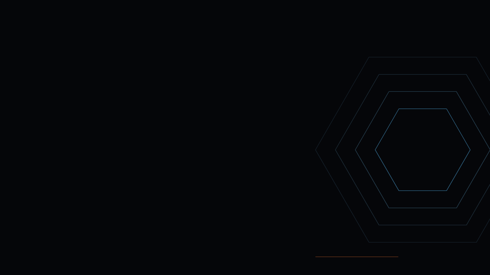
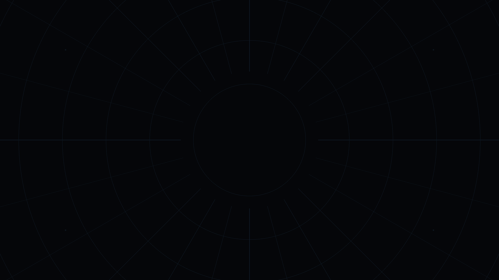
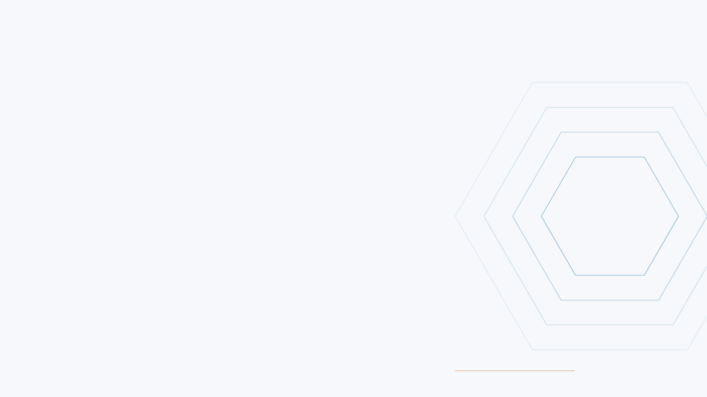
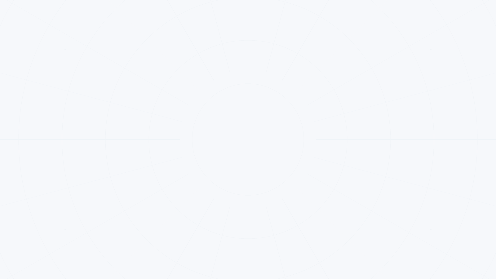
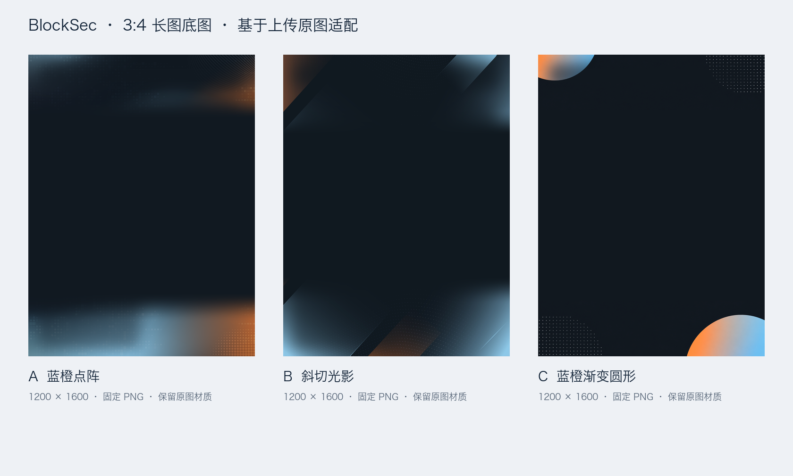
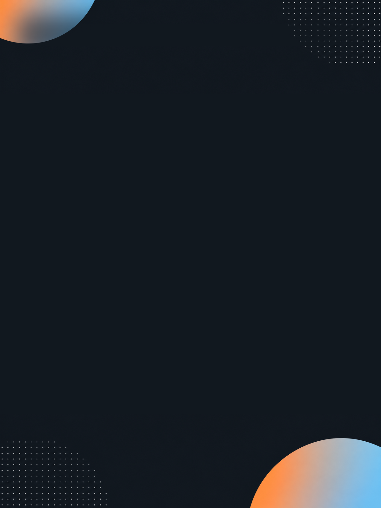

# Blocksec内容营销配图：详细使用手册

系统支持两种交付：无需标题 / Logo 的无字底图资产，以及同时保留干净背景和独立图层的可编辑完整封面项目。完整成品均保存 PNG / WebP、背景参数、平台配置与可重编译运行脚本；[项目结构与命令](asset-model.md) 说明 Blog、X、LinkedIn、微信公众号和 OG 的派生规则。

本包按 BlockSec 领英 / X 的内容场景制作配图：Partnership 合作公告、活动、安全周报 / 阶段汇总、安全事件分析、产品更新与研究观点。每种内容再选择合适的封面、金句、概要或合作动图形式；官网、落地页和邮件的产品营销动图另有 Carrot 索引入口。

**显示名称：Blocksec内容营销配图。** 技术标识和原有调用入口保留 `$blocksec-social-cover`，已有使用方式继续有效。

在对话中提供图片、正式 Logo 或已有项目目录，再输入指令与中文需求即可。以下 `/...` 是 skill 的对话子指令，无需在终端运行。

## 首次使用

在当前对话中第一次调用任意子指令时，skill 会先介绍可制作的内容类型和能力，再询问你要制作哪一种。Codex 的问答工具可用且当前模式允许调用时，使用结构化选择；ChatGPT 按当前会话提供的能力交互。没有可用选择工具时，以普通中文问句完成同样的流程。可选范围包括：

- **现有内容类型配图**：Partnership 合作公告、活动、Security Roundup 安全周报 / 阶段汇总、Incident Analysis 安全事件分析、Product Updates 产品更新、Research & Insights 研究与行业观点。
- **辅助与动效能力**：嘉宾金句、活动概要、人物透明 PNG、纯黑 / 蓝橙静态风格、合作静图转动图、产品营销动图、参考图拆解和图层合成参数。
- **都不是，新建配图类型**：描述你希望制作的帖子类型和用途，skill 会继续收集合作方 / 嘉宾 / 产品、发布平台、尺寸或文件要求、文案与素材，并建议提供参考图。

准备参考素材时，X 帖子可以将链接粘贴到 [x-downloader.com](https://x-downloader.com/en/) 下载图片、GIF 或视频；LinkedIn 视频可以使用 [Taplio LinkedIn Video Downloader](https://taplio.com/linkedin-video-downloader)，静态图则直接保存原图。下载后回到当前窗口，将文件上传给 AI；已经有本地文件时直接上传即可。

具体提问、Codex `request_user_input` 参数格式、ChatGPT 回退与分流规则见 [首次调用提问脚本](../references/first-invocation.md)。

## 参考图贡献与 skill 共建

`/analyze-reference` 是普通用户可以主动选择的 **参考贡献与共建入口**。日常用已有类型出图不需要先调用它；有优秀参考、希望改进现有类型或增加可复用类型时，可直接调用，也可以从首次引导的“都不是，新建配图类型”进入。

**同事从这里开始：** 查看 [用户共建指南](../references/contributors-guide.md)。完整流程是：

1. 调用 `/analyze-reference`，说明希望贡献的内容类型和用途。
2. 上传已有参考、文案与素材，指出想借鉴或改进的部分。
3. 查看 AI 整理的设计规格、可实现范围和适用验证预览。
4. 用中文反馈或确认采用；已有明确授权时不重复询问。
5. 将经过验证的方案加入共享参考库，再按发布权限更新团队版本。
6. 后续出图直接指定已验证的方案名称，复用团队成果。

贡献者负责提供参考和反馈，维护者负责源码合并与验证，有发布权限的同事负责更新工作区。不同本地副本不会自动同步；没有源码访问权时，也可以先提交贡献文件供维护者合并。

调用者提供参考图、帖子用途和希望借鉴的特点，agent 负责拆解、整理候选规格、验证适用性，并将可复用方案维护到当前 skill 源码的参考库。用户无需手动编辑 JSON。贡献内容可以包括：

- 适合的内容类型：Partnership、活动、安全周报、安全事件分析、产品更新或研究观点。
- 字体判断：字体风格、字重、大小层级、字距、行距、大小写规则；如果仅凭图片无法确认具体字体，会提供候选字体和判断置信度。
- 版式参数：画布比例、文字与画布的归一化坐标、宽高、边距、对齐方式、Logo / 人物 / 截图的位置。
- 素材图层：底色、渐变、网格、光晕、纹理、Logo、人物、截图、遮罩、装饰线和前后层级。
- 底图提示词：为 BlockSec 纯黑或蓝橙风格整理可用于 image_gen 的无字、无 Logo 背景提示词。
- 合成参数：输出可复用的 `reference-spec.json`，记录图层、坐标、尺寸、颜色、透明度、字体、字号和适配规则。
- 新内容映射：使用同样的视觉规则制作一张新的 BlockSec 配图，保留 BlockSec 正式 Logo 和本次确认的文案。

参考图用于提炼结构和视觉规则，不直接复制第三方 Logo、原文、人物身份、独特插画或未授权素材。具体字体名称无法从普通位图完全确定时，会明确标注“推断”与备选方案；最终以用户提供的字体文件或可识别的原始设计文件为准。

共建示例：

```text
/analyze-reference
我想和其他使用者共同维护这个 skill。
分析我上传的这组优秀 Web3 配图，提炼适合 BlockSec 的 Partnership 和安全周报两种视觉规则。
请分别输出字体/字号层级、文字和 Logo 的相对位置、素材图层、纯黑与蓝橙两版底图 image_gen 提示词，以及可复用的 reference-spec.json。
整理成可审阅的贡献，验证后加入共享参考库，让后续用户可以复用。
不要复制原图的 Logo、文案、人物或独特插画。
```

共建也可以同时制作验证用的新图：

```text
/analyze-reference
参考这张活动宣传图的版式和层级，制作一张 BlockSec 活动预告配图。
将经过验证的版式作为现有活动类型的新参考方案供大家复用。
保留参考的阅读节奏和结构关系，但使用 BlockSec 纯黑风格、正式 Logo 和我提供的活动信息。
```

共建会保留原有默认方案，用独立名称和版本记录新贡献。候选方案完成分析后会展示规格、实际可渲染范围和待确认项；确认要采用且完成验证的方案才作为正常出图的可选参考。用户已经明确授权入库或自动推进时，不重复要求确认。

参考库索引见 [assets/reference-library/index.json](../assets/reference-library/index.json)。当前索引已建立，尚无通过本流程登记的贡献；原有模板继续可用。大家的贡献落在各自可写的 skill 源码副本，跨用户共享还需将变更同步到团队使用的源码版本。

如果只想得到当前项目的分析、不贡献到共享库，在指令后明确写“只分析，不入库”。普通用户仅需参考某图完成一次出图，也可以在原出图请求中直接附参考图。完整规则见 [参考图拆解与共建](../references/reference-analysis.md)。

## 团队使用与维护后的更新提醒

日常运营同事可以用 ChatGPT Work 提供文案和素材、制作配图；维护模板、脚本、参考库和动画工具的同事建议使用本地 Codex。当前版本需要在目标环境验证正式素材、字体、Python 和 image_gen；上传到工作区不会自动准备所有本地依赖。

共建或维护后，会先生成候选更新包和文件清单，再询问“是否将此次维护更新上传到 Blocksec 团队空间？”。一次性出图不会触发。已有明确上传授权时不重复确认。

源码中提供了项目级 Codex hook 配置；实际启用需要客户端支持、项目 / hook 信任及工作区策略允许。ChatGPT Work 云端使用对话提醒，不能认为上传 skill ZIP 就安装了本地 hook。团队分享建议采用源码协作与维护者发布流程，具体权限以 Blocksec 工作区设置为准。

使用说明和打包方式见 [团队分享与更新规则](../references/team-sharing.md)。

## 新底图与图层合成

普通配图默认复用已有底图。明确要求“从零绘制”或“根据参考图和素材新绘制底图”时，agent 必须调用原生 `image_gen` / `image_generation`，网格、渐变、圆弧等几何背景也适用。程序只负责已有底图、准确文字、官方 Logo、人物和截图等图层的排版合成，不新画底图。图像工具不可用或没有返回可用图片时，说明新底图尚未完成，不自动用程序绘制或预设替代。

例如：

```text
使用 $blocksec-social-cover，根据附上的参考图和素材新绘制一张无字底图。
调用 image_gen，保留当前模板需要的文字和 Logo 留白；生成后再合成已确认文案与正式 Logo。
```

## 按领英 / X 内容类型选择配图

先告诉 agent “这是一条什么内容”，再提供已确认文案与素材。用户无需先选择模板 ID、抠图工具或动画参数。下列是本包的内容场景分类，底层继续复用已有七套静态模板；具体的周期、文案与发布日期以本次素材为准。

| 内容类型 | 常见发布内容 | 默认图片形式 | 使用方式 |
| --- | --- | --- | --- |
| **Partnership / 合作公告** | 新合作、合作范围、联合发布 | 居中双 Logo 合作图；已有左对齐项目沿用原版。需要动效时使用背景网格循环 | `$blocksec-social-cover` + “合作公告”；动效用 `/animate-cover` |
| **Events / 活动** | 活动预告、参会 / 演讲信息、seminar / webinar 宣传、活动回顾 | 预告使用横版封面；回顾使用 1–4 条要点概要；嘉宾观点使用金句 / 人物卡 | 说明“预告 / 回顾 / 嘉宾金句”；对应 `/seminar-summary` 或 `/speaker-quote` |
| **Security Roundup / 安全周报与阶段汇总** | 周报、双周或其他周期的安全事件汇总、监测观察 | 标题 + 明确日期范围的横版封面；需要展示精选要点时使用概要模板 | `$blocksec-social-cover` + “安全周报”或“安全汇总” |
| **Incident Analysis / 安全事件分析** | 单个攻击事件、漏洞分析、事件复盘、调查文章推广 | 事件标题 + 核心已确认信息的横版分析封面，可放原始图表 / 截图 | `$blocksec-social-cover` + “安全事件分析配图” |
| **Product Updates / 产品发布与功能更新** | 产品发布、新功能、功能升级、使用场景或教程推广 | 横版产品更新封面，可放已确认的真实 UI 截图 | `$blocksec-social-cover` + “产品更新配图” |
| **Research & Insights / 研究与行业观点** | 研究文章、技术解读、行业观察、专家观点 | 文章封面；署名观点使用横版人物卡 | `$blocksec-social-cover` + “研究文章封面”或“专家观点卡” |

安全周报 / 事件分析目前使用已有封面或概要模板组织内容，尚无专门的统计看板、事件时间线或自动数据采集器。固定模板与类型的映射规则见 [内容类型与制作规则](../references/content-types.md)。

官网、落地页和邮件中的产品功能动画使用 `/product-motion`；该入口按 Carrot 的投放范围执行，不能仅因社交产品更新需要“动图”就自动进入 Carrot。

## 中文使用示例：按内容制作

### Partnership：合作公告

```text
使用 $blocksec-social-cover 制作一张用于领英 / X 的 partnership 合作公告。
使用附上的正式 BlockSec Logo 和合作方 Logo，默认采用居中合作版式，复用已有底图。
标题：这里填写确认后的标题
合作说明：这里填写已确认的合作范围
```

### 活动：预告、回顾与嘉宾金句

```text
使用 $blocksec-social-cover 制作一张活动预告配图，用于领英 / X。
活动名：这里填写活动名称
日期与时区：这里填写确认后的时间
主题：这里填写活动主题
使用附上的正式素材，只放已确认的信息。
```

活动结束后，可制作无人物概要：

```text
/seminar-summary
将这场活动的已确认要点制作成 3:4 回顾概要，复用固定底图。
活动名：这里填写活动名称
要点：这里填写 1–4 条已确认的要点
```

需要突出某位嘉宾观点时：

```text
/speaker-quote
使用附上的嘉宾原照片制作活动金句配图。
金句：这里填写确认后的原文
姓名：这里填写嘉宾姓名
职位与机构：这里填写职位与机构
```

### 安全周报：封面或精选要点

```text
使用 $blocksec-social-cover 制作一张用于领英 / X 的安全周报封面。
栏目标题：这里填写本期标题
统计日期范围：这里填写明确的起止日期
摘要：这里填写已确认的安全观察
复用已有深色底图，保留正式 BlockSec Logo；所有数字以我提供的资料为准。
```

想直接在图中展示精选事件时，可改为“用概要形式展示这 1–4 条已确认的事件要点”。

### 安全事件分析：单篇复盘推广

```text
使用 $blocksec-social-cover 为这篇安全事件分析制作领英 / X 配图。
标题：这里填写已确认的事件标题
核心发现：这里填写已确认的一条发现
使用附上的图表或截图作为可选主视觉，不补造损失金额、受影响项目或攻击原因。
```

### 产品更新：功能发布配图

```text
使用 $blocksec-social-cover 制作一张产品更新配图，用于领英 / X。
产品与功能：这里填写产品及功能名称
标题：这里填写发布标题
价值说明：这里填写已确认的功能价值
使用附上的真实 UI 截图，保持产品原生颜色、标签和状态。
```

### 研究与观点：文章或人物卡

```text
使用 $blocksec-social-cover 为这篇研究文章制作一张领英 / X 封面。
标题：这里填写文章标题
说明：这里填写已确认的一句摘要
复用已有底图，右侧使用附上的主视觉；没有主视觉时不虚构素材。
```

署名观点可写成“制作横版专家观点卡”，并附原文、姓名、身份与人物照片。

## 底层排版模板与素材处理

默认由 agent 按对应模板完成第一版，之后可以继续用自然语言修改。每种模板的文字、Logo 和人物位置与大小都有保存的默认参数；只改文案或换素材时，保留该图片已保存的排版调整。localhost 微调页面尚未实现。

| 配图类型 | 可用模板 | 默认排版与素材 | 尺寸 |
| --- | --- | --- | --- |
| 文章 / 产品更新封面 | **文章封面｜横版** `article-cover-landscape` | 上方 BlockSec Logo；左侧分类标签、主标题、说明；右侧可放产品截图或插图 | 1600×900 |
| 合作公告 | **合作公告｜居中横版** `partnership-announcement-centered`（新建合作图默认） | 顶部双方 Logo 和连接符；居中标题与说明；无人物位 | 1600×900 |
| 合作公告 | **合作公告｜极简双 Logo 横版** `partnership-announcement-minimal` | 白底浅网格、蓝橙边角柔光；中央双方 Logo + ×；无标题；独立相对位置参数 | 1600×900 |
| 合作公告 | **合作公告｜左对齐横版** `partnership-announcement-left` | 顶部双方 Logo 和连接符；左对齐标题与说明；保留原有合作版式 | 1600×900 |
| 观点 / 人物卡 | **观点人物卡｜横版** `opinion-card-landscape` | 上方 BlockSec Logo；左侧观点、姓名 / 身份说明；右侧人物 | 1600×900 |
| 嘉宾金句 | **嘉宾金句｜竖版** `speaker-quote-portrait` | 顶部活动信息和 BlockSec Logo；上半部金句；下方左侧补充金句与姓名职位，右侧透明人物 | 1200×1600 |
| 活动概要 | **活动概要｜竖版** `seminar-summary-portrait` | 顶部活动信息和 BlockSec Logo；概要标题；1–4 条确认的要点；无人物位 | 1200×1600 |
| 人物抠图 | `/speaker-cutout`，无海报排版模板 | 保留可见人物，输出独立透明 PNG，不附加 Logo 和文案 | 随原始素材 |
| 合作背景循环动图 | `/animate-cover` + `partnership-grid-flow` | 基于合作静态母版；文字与 Logo 固定，网格背景循环 | 默认保持源图尺寸 |
| 产品营销动图 | `/product-motion` / `$carrot` | 由外部 Carrot 按产品材料和投放场景制作；本包不附固定静图模板 | 以项目要求为准 |

七套静图的参数文件见 [模板索引](../assets/templates/index.json)，具体元素名称与保存规则见 [模板参数说明](../references/template-parameters.md)。上述尺寸是本包默认设计画幅。

## 制作与修改工具

| 需求 | 英文指令 / 入口 | 执行方式 |
| --- | --- | --- |
| 静态品牌封面、合作公告、局部修改 | `$blocksec-social-cover` + 中文需求 | 本包模板 |
| 嘉宾金句 / 活动概要 / 人物抠图 | `/speaker-quote` / `/seminar-summary` / `/speaker-cutout` | 本包工作流 |
| 合作静图转换为背景循环动图 | `/animate-cover` | 本包的静图风格与动效配方 |
| 官网、落地页、邮件的产品营销动图 | `/product-motion` 或直接 `$carrot` | 已安装的外部 Carrot 技能 |

先判断传播目标：让现有合作海报的背景动起来，用 `/animate-cover`；让观众理解产品功能、操作或价值，用 `/product-motion`。

## 默认样式与完整效果图

底图以小尺寸预览展示，点击图片即可打开原图查看细节。

完整效果图应展示实际模板叠加 **正式 Logo、示例文案以及该类型所需的人物 / 主视觉** 后的成品。合作公告和活动概要本身没有人物位，按模板展示 Logo 与文案；人物抠图示例展示原照片与透明人物的对应关系。

当前完整效果图状态：**极简 Partnership 已完成，其余逐类收集素材并制作**。包内已有正式 BlockSec 与产品 Logo 及固定底图，具体合作方、人物和示例文案仍需按本次用途确认；以下列出默认效果和待补成品，不以底图或第三方参考图代替本模板的完整效果图。

### 文章封面｜横版

- 模板：[article-cover-landscape.json](../assets/templates/article-cover-landscape.json)。
- 示例默认样式：深色蓝橙、白色主标题、灰色说明、橙色分类标签；左侧文案，右侧产品截图 / 插图，上方正式 BlockSec Logo。
- 示例底图：六边形轮廓 hex-outline；也可从下方横版图库切换。

<a href="../assets/backgrounds/hex-outline.png"></a>

- 完整效果图：待提供正式 Logo、示例标题与说明、可选产品截图 / 插图。制作后保存为 `assets/examples/article-cover-landscape/cover.png` 并在这里嵌入。

### 合作公告｜居中横版（默认合作模板）

- 模板：[partnership-announcement-centered.json](../assets/templates/partnership-announcement-centered.json)。
- 默认样式：深色蓝橙，双方正式 Logo 沿画布中心轴平衡排列，白色标题和灰色说明逐行居中。
- 推荐底图：对称放射网格 radial-grid-symmetric。支持浅色主题，浅色出图需选相应正式 Logo 版本。

<a href="../assets/backgrounds/radial-grid-symmetric.png"></a>

- 完整效果图：待提供双方正式 Logo、确认的示例合作标题与说明。制作后保存为 `assets/examples/partnership-announcement-centered/cover.png` 并在这里嵌入。

### 合作公告｜极简双 Logo 横版

- 新增模板：[partnership-announcement-minimal.json](../assets/templates/partnership-announcement-minimal.json)，使用 `layout: partnership-minimal`。适合只展示双方 Logo 的合作公告，不添加标题或说明。
- 固定底图：partnership-soft-grid-light.png（1600×900），可编辑 [SVG 源文件](../assets/backgrounds/partnership-soft-grid-light.svg)；浅网格与蓝橙边角柔光，中央留白。

<a href="../assets/backgrounds/partnership-soft-grid-light.png"></a>

- 暖橙变体：partnership-orange-grid-light.png，使用 BlockSec 橙色 / 琥珀色渐变，保留少量蓝色边缘平衡；可用 [暖橙渐变 Partnership 指令](../references/partnership-orange-grid.md) 自行创作类似底图或完整 Partnership 构图。

<a href="../assets/backgrounds/partnership-orange-grid-light.png"></a>

- 双方 Logo 的像素框、相对中心、比例及间距见 [制作与参数说明](../references/partnership-minimal.md)；左中心 (26.25%, 50%)，右中心 (73.75%, 50%)，乘号中心 (50%, 50%)。
- 乘号素材：[深墨色透明 PNG](../assets/marks/partnership-cross-ink.png) / [SVG](../assets/marks/partnership-cross-ink.svg)，另有白色与橙色版本，默认独立加载并保存在项目中。
- 内容起点：[example-partnership-minimal.json](../assets/example-partnership-minimal.json)。提供正式双方 Logo 后即可出图；风格参考中的 Elliptic / Internet Computer Logo 不用于本模板成品。
- 完整效果图：BlockSec × RedotPay 无文案版式示例，用户允许用于 README；仅展示模板，不作为独立核实的合作公告。

<a href="../assets/examples/partnership-redotpay-minimal/cover.png"></a>

### 合作公告｜左对齐横版

- 模板：[partnership-announcement-left.json](../assets/templates/partnership-announcement-left.json)。
- 示例默认样式：深色蓝橙，顶部双方正式 Logo 和连接符，下方左对齐大标题与说明；无人物位。
- 示例底图：柔和绸缎 soft-satin。可切换为其他已有横版底图。

<a href="../assets/backgrounds/soft-satin.png"></a>

- 完整效果图：可复用居中合作示例的双方 Logo 和文案，直接比较两个版式。制作后保存为 `assets/examples/partnership-announcement-left/cover.png` 并在这里嵌入。

### 观点人物卡｜横版

- 模板：[opinion-card-landscape.json](../assets/templates/opinion-card-landscape.json)。
- 示例默认样式：深色蓝橙、左侧白色观点主文案和灰色姓名 / 身份说明，右侧人物，上方正式 BlockSec Logo。
- 示例底图：六边形轮廓 hex-outline。

<a href="../assets/backgrounds/hex-outline.png"></a>

- 完整效果图：待提供正式 Logo、允许用于示例的人物照片、确认的观点和身份。制作后保存为 `assets/examples/opinion-card-landscape/cover.png` 并在这里嵌入。

### 嘉宾金句｜竖版

- 模板：[speaker-quote-portrait.json](../assets/templates/speaker-quote-portrait.json)。
- 默认样式：深色蓝橙，上方活动信息与正式 BlockSec Logo；大引号与重点词用橙色，金句用白色；右下透明人物，左下姓名 / 职位 / 机构。
- 默认底图：A 蓝橙点阵 portrait-data-glow；可选 B 斜切光影、C 蓝橙渐变圆形。

<a href="../assets/backgrounds/portrait-data-glow.png"></a>

- 完整效果图：待提供正式 Logo、人物原照片、姓名职位和确认金句。制作后保存为 `assets/examples/speaker-quote-portrait/speaker-quote.png` 并在这里嵌入，人物透明素材单独保留。

### 活动概要｜竖版

- 模板：[seminar-summary-portrait.json](../assets/templates/seminar-summary-portrait.json)。
- 默认样式：深色底，活动信息、正式 BlockSec Logo 和白色大标题；要点标题 / 短强调线用橙色，正文白色；不放人物。
- 默认底图：B 斜切光影 portrait-diagonal-light；也可选 A / C。

<a href="../assets/backgrounds/portrait-diagonal-light.png"></a>

- 完整效果图：待提供正式 Logo、概要标题与 1–4 条示例要点。制作后保存为 `assets/examples/seminar-summary-portrait/seminar-summary.png` 并在这里嵌入。

### 可用底图与主题

底图与排版模板独立，换底图不会自动更换文字对齐或素材位置。四套横版静图可选以下四种底图，各有深色和浅色版本；新建未指定主题时默认深色。竖版两套模板优先共用 A / B / C 三张原图适配深色底图；原有竖版预设保留以兼容已有项目。

| 横版底图 | 深色预览 | 浅色预览 |
| --- | --- | --- |
| 六边形轮廓 `hex-outline` | <a href="../assets/backgrounds/hex-outline.png"></a> | <a href="../assets/backgrounds/hex-outline-light.png"></a> |
| 六边形光晕 `hex-glow` | <a href="../assets/backgrounds/hex-glow.png"></a> | <a href="../assets/backgrounds/hex-glow-light.png"></a> |
| 柔和绸缎 `soft-satin` | <a href="../assets/backgrounds/soft-satin.png"></a> | <a href="../assets/backgrounds/soft-satin-light.png"></a> |
| 对称放射网格 `radial-grid-symmetric` | <a href="../assets/backgrounds/radial-grid-symmetric.png"></a> | <a href="../assets/backgrounds/radial-grid-symmetric-light.png"></a> |

下面是竖版 **底图选择预览**，仅用于选择 A / B / C，不是完整海报效果图：

<a href="../assets/references/portrait-background-options-v2.png"></a>

| 竖版底图 | 底图预览 | 推荐用途 |
| --- | --- | --- |
| A 蓝橙点阵 `portrait-data-glow` | <a href="../assets/backgrounds/portrait-data-glow.png"></a> | 嘉宾金句、Web3 活动回顾 |
| B 斜切光影 `portrait-diagonal-light` | <a href="../assets/backgrounds/portrait-diagonal-light.png"></a> | Seminar 概要、要点长图 |
| C 蓝橙渐变圆形 `portrait-gradient-spheres` | <a href="../assets/backgrounds/portrait-gradient-spheres.png"></a> | 嘉宾金句、活动宣传 |

三张均为 1200×1600，根据 `inbox/backgrounds/` 的原始渐变、点阵与光影素材等比纵向重排，中央保留连续深色文字区。普通出图直接复用固定 PNG；仅用户明确要求才生成新底图，原图与旧预设保留。

合作动图的完整预览需先使用正式素材制作静态母版，再实际渲染循环成片；不把示意帧当作已完成的动画。产品营销动图按 Carrot 的实际项目单独展示，不承诺固定的人物 / Logo 布局。

## 用户原始素材统一收件

用户通过对话或拖拽提供的 Logo、人物照片、截图、文案和参考图，统一保存在 **`inbox/materials/`**，并按收到的批次记录用途。用户可直接拖入本目录，不需要掌握设计工具或目录结构。详细规则见 [素材收件说明](../inbox/materials/README.md)。正式 Logo 使用副本及透明 PNG 在 [Logo 目录](../assets/logos/README.md)，[Logo 索引](../assets/logos/index.json) 收录 BlockSec、MetaSleuth、MetaSuites、Phalcon，记录实际颜色、适用背景、原文件与合成文件。Phalcon Compliance 已收录 [独立专属 SVG](../assets/logos/phalcon-compliance/phalcon-compliance-lockup-dark.svg) 和 [透明 PNG](../assets/logos/phalcon-compliance/phalcon-compliance-lockup-dark.png)，浅底默认使用深蓝灰版本；此前含背景与宣传语的横幅继续保留为参考素材。agent 制作前先匹配品牌再选择可用版本。Media Kit 的完整 Logo、独立图标、横幅与社交图标见 [素材说明与预览](../references/media-kit.md)；后续可直接说“使用 MetaSleuth 白色完整 Logo”或“使用 Phalcon 蓝色图标”。

agent 整理时按香港日期和用途建立可辨识批次，例如 `2026-10-14-template-examples`，保留原文件名并记录中文素材名称。原照片保留，抠图、转换及海报使用副本；同名素材不覆盖。仅供参考的图片与可正式使用的素材明确区分。背景原图沿用已有 **`inbox/backgrounds/`**，不迁移已有文件。

制作本页效果图时，可复用一组示例素材：正式 BlockSec Logo、一个合作方 Logo、一张允许用于示例的嘉宾照片及姓名职位、确认的示例文案；文章封面的产品截图 / 插图可另外提供。素材确认后，各示例保留独立项目配置和实际使用的副本，便于以后替换样例。

## Partnership：合作静图转动图

静图和循环动图是同一配图的两种呈现，不是两类内容。合作公告、活动等都沿用原 cover project 的文案、背景、Logo、素材和版式；目前已验证的运动配方为 `partnership-grid-flow`，适用于有实际独立网格 / 线性纹理层的画面。其他背景不为了套配方添加网格或换底图。

### 示例一：同主题同时交付静态与动态版本

```text
/animate-cover
为这个已确认的配图项目导出 X 和 LinkedIn 横版的静图与循环动图。
沿用现有底图、配色、文案和正式 Logo，只让原有背景网格缓慢流动。
静图交付 PNG / WebP，动图交付 5 秒无声 MP4，保留同一可编辑项目。
```

### 示例二：只改标题，同时更新两种版本

```text
把这个项目的标题替换为下面的确认文案，其他内容与底图保持。
请同时更新静态配图和循环 GIF，并保留 MP4。
```

### 示例三：用户主动要求换成单橙方向

```text
将这套配图调整为单橙色方向，不强加蓝色或渐变。
保留文字、Logo 原色、构图和画幅；按实际素材情况处理背景。
确认母版后，静态和动态版本使用同一套颜色和图层。
```

默认 `style=preserve`，不先把原图改成纯黑或蓝橙。可选设计方向有单蓝、单橙、蓝橙组合、纯黑 / 黑白灰；这些是设计意图，不是渲染器自动重配色功能。新绘制仍需用户明确要求，并调用原生 image_gen。

### 项目与执行

`project.json` 的可选 motion 指向同项目的动效配置，文案仍只保存在原 content.json。通过 `cover_project.py motion` 收集真实动画源，再以统一 export / rebuild 的 `--presentation static|motion|both` 导出或更新。默认只出静图；用户明确要求动态才编码视频。

内置 layer-loop 对已有独立纹理和遮罩做周期位移；HyperFrames 等执行器可制作纯背景序列，接入 background-frames 后共用准确前景。两种接入都需真实素材，默认不重新生成背景。MP4 / GIF 编码需 FFmpeg，动态格式、尺寸、时长按实际投放规格核对，不认为所有平台的播放行为相同。

只有扁平图片时，先找原项目或独立素材；不能假设文字下面有干净背景，不能让整张海报一起平移冒充网格动画。无法取得可靠源时保留已完成静图和缺失素材说明，不把提示词称为动图。

交付 PNG / WebP、MP4 / GIF、poster 和同一个可编辑项目；改标题后带 motion 再导出即可同步前景，背景动画源可复用。技术命令、schema、素材路径和验收见 [统一静态与动态工作流](static-to-motion.md)。

## 产品营销动图

使用英文指令 **`/product-motion`**，后面直接用中文说明产品、传播重点和投放位置。这是本包对已安装 `$carrot` 的索引入口；也可以直接使用 `$carrot`。

Carrot 从本地 `blocksec-product-knowledge` 查找已确认的产品事实和可用素材，选择真实 UI、基于证据的简化 UI 或概念化 2D 动画，完成脚本、素材准备、制作和验收。当前包不内置 Carrot；分享或迁移本包时，需要在目标环境另外提供完整的 Carrot 技能及其运行依赖。

### 示例一：落地页功能动图

```text
/product-motion
为 Phalcon Compliance 的 Monitor 功能制作一段用于落地页的产品营销动图。
让客户看懂这个功能的主要价值，具体能力和页面状态以本地知识库为准。
优先使用已有真实产品素材，画面简洁，无旁白。
```

### 示例二：邮件营销 GIF

```text
/product-motion
我需要一张 Phalcon Compliance 产品邮件中的营销 GIF。
围绕知识库已确认的一个核心能力，展示一个关键动作和清晰结果。
营销背景使用 BlockSec 蓝橙风格，真实产品 UI 保持原样。
同时提供可作为静态替代的图片。
```

### 示例三：直接调用 Carrot

```text
$carrot
为 Phalcon Compliance 制作一段官网首页产品动画。
先阅读本地产品知识库，提炼一个最值得展示的价值点。
使用简洁的 2D 表达，不需要我提供动画术语或完整分镜。
```

只要说明“产品/功能 + 想让观众理解什么”，投放位置和参考想法可以补充，无需填写 `/animate-cover` 的 `style`、`type`、时长、帧率等参数。已有要求会原样传递给 Carrot。

### 适用范围与交付

- 适用于官网首页、落地页和邮件中的短篇 2D 产品营销动画；支持真实 UI、简化 UI 和概念表达。
- 3D、长篇配音教程和以社交平台剪辑为主的视频不自动交给 Carrot；合作海报的背景循环继续用 `/animate-cover`。
- 官网/落地页通常交付 WebM/MP4 和静态 poster；邮件按需求交付 GIF、预览与 fallback，并保留源项目。Carrot 新项目默认 Full HD 1920×1080，已有项目尺寸和用户明确要求优先。
- 纯黑或蓝橙可用于营销背景和装饰；真实 UI 的原生颜色、控件和状态必须保留。默认风格按 Carrot 的投放场景规范选择，不强制套用合作海报配方。
- Carrot 按其当前流程整理脚本与素材并完成适用检查；默认在制作前需要脚本确认，已有授权或用户明确要求自动推进时依其流程执行。
- Carrot 不可用时会说明缺少外部技能；索引本身不能替代动画制作引擎。

完整入口规则见 [产品营销动图 / Carrot 索引](../references/product-motion.md)。

## 后续修改

### 只修改现有配图的标题

```text
使用 $blocksec-social-cover 修改这个已有项目。
只将标题改为“这里填写新标题”，保留其他文字、素材、底图和布局。
```

进阶分析与动效配方维护（包括仅提炼提示词）见 [静图转动图工作流](../references/static-to-motion.md)；日常制作按上方内容类型直接提出出图需求。

详细制作规则见 [SKILL.md](../SKILL.md)。
